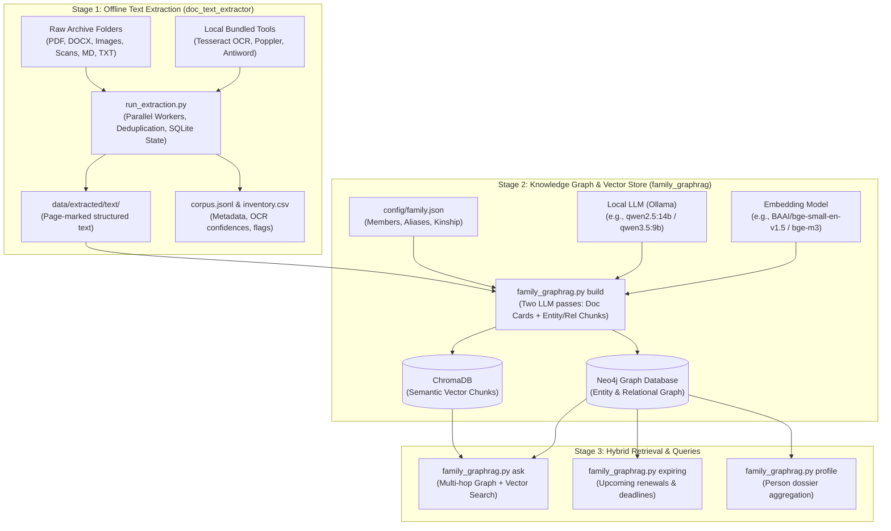

# Documents Knowledge Graph (Family GraphRAG)

An offline, privacy-first **Document Intelligence & Knowledge Graph** system tailored for personal and family archives. It processes government IDs, educational certificates, medical records, financial statements, insurance policies, warranties, legal agreements, receipts, and photos/videos — transforming raw files into a queryable **Neo4j Knowledge Graph** and **ChromaDB Vector Store** powered by local LLMs.

---

## Architecture Overview



---

## Key Features

- **100% Offline & Private:** No sensitive data leaves your machine. Refuses remote LLM endpoints by default and includes automatic PII masking (Aadhaar, PAN, passports, emails) if remote fallback is explicitly allowed.
- **Multi-Format Extraction:** Automatically extracts text from digital and scanned PDFs, Word (`.docx`, `.doc`), Excel (`.xlsx`, `.xls`, `.xlsb`), PowerPoint (`.pptx`, `.ppt`), RTF, OpenDocument, HTML/MHT, XML, Outlook emails (`.msg`, `.eml`), ZIP archives, and images (`.jpg`, `.png`, `.heic`, `.webp`).
- **Multilingual OCR:** Built-in multi-language OCR using local Tesseract (`eng`, `tel`, `hin`, and 150+ language packs) with orientation correction, deskewing, and despeckling.
- **Smart Deduplication & Resume:** Uses SHA-256 hashing to extract duplicate files once and reuse structured results; incremental runs skip unchanged files automatically.
- **Two-Pass Knowledge Graph (Family GraphRAG):**
  1. **Document Cards:** Extracts document category, issuer, holder, validity dates, amounts, and document numbers.
  2. **Chunk Relations:** Strictly schema-driven extraction of entities (Person, Organization, Asset, Event) and relationships across text chunks.
- **Family Roster Integration:** Maps informal references (e.g., *"Mom"*, *"Kanna"*, *"Dad"*) to formal identities using `config/family.json`.
- **Dedicated Discovery Commands:** Natural language QA (`ask`), deadline tracking (`expiring`), and member profile compilation (`profile`).

---

## Repository Structure

```
Documents_Knowledge_Graph/
├── config/
│   ├── family.json              # Family member identities, aliases, and relationships
│   └── settings.env             # Environment variables (LLM, Neo4j, Embedding settings)
├── data/
│   ├── extracted/               # Output from doc_text_extractor
│   │   ├── text/                # Page-marked text files matching source directory layout
│   │   ├── corpus.jsonl         # Detailed JSONL records per document and attachment
│   │   ├── inventory.csv        # Comprehensive file audit with formats, methods, and status
│   │   ├── summary.json         # High-level run metrics and execution timings
│   │   ├── run_manifest.json    # Tool versions and options applied
│   │   └── state.sqlite         # Cache database for SHA deduplication and resume tracking
│   ├── graph/                   # Graph exports or local checkpoints
│   └── originals/               # (Optional) Local document source directory
├── local_installations/         # Bundled offline binary tools
│   ├── antiword/                # Word 97-2003 (.doc) binary extraction utility
│   ├── poppler-26.09.0/         # Poppler PDF rendering and extraction tools
│   └── Tesseract-OCR/           # Tesseract OCR engine and traineddata language models
├── src/
│   ├── doc_text_extractor/      # Document ingestion engine
│   │   ├── core/                # Format detection, OCR preprocessing, and dispatching
│   │   ├── extractors/          # Specialized extractors per file type
│   │   ├── ocr_config.py        # Local binary auto-discovery (Tesseract, Poppler, Antiword)
│   │   └── run_extraction.py    # Multi-worker runner CLI
│   └── family_graphrag.py       # GraphRAG indexer, vector builder, and query interface
├── requirements.txt             # Python package dependencies
└── README.md
```

---

## Prerequisites & Installation

### 1. Python Environment

Create and activate a virtual environment, then install dependencies:

```powershell
python -m venv venv
.\venv\Scripts\Activate.ps1
pip install -r requirements.txt
```

To install the additional GraphRAG packages:
```powershell
pip install chromadb sentence-transformers neo4j openai tqdm
```

### 2. Local Binaries

Bundled standalone binaries are located in `local_installations/` and discovered automatically by `ocr_config.py`:
- **Tesseract-OCR:** OCR engine and `tessdata` (includes `eng`, `tel`, `hin`, etc.).
- **Poppler:** `Library/bin` with `pdftotext`, `pdftoppm`.
- **Antiword:** Legacy MS Word (.doc) extractor.

*(Optional)* If LibreOffice is installed on the system PATH or Program Files, it will also be detected for complex conversions.

### 3. Neo4j Graph Database

Start Neo4j using Docker:

```powershell
docker run -d `
  -p 127.0.0.1:7474:7474 -p 127.0.0.1:7687:7687 `
  -e NEO4J_AUTH=neo4j/your-password `
  -v ${PWD}/data/graph/neo4j_data:/data `
  --name family-neo4j neo4j:5
```

### 4. Local LLM (Ollama)

Start [Ollama](https://ollama.com/) and pull your chosen model:

```powershell
ollama pull qwen2.5:14b
# or lightweight models such as:
ollama pull qwen3.5:9b
```

---

## Configuration

### `config/family.json`
Define members, known aliases (used in certificates or spoken names), and kinships to ground entity resolution:

```json
{
  "members": [
    {
      "name": "Saketh",
      "relation_to_me": "self",
      "aliases": ["Botte Saketh", "Saketh Botte", "Saketh Yadav"]
    },
    {
      "name": "Saibabu",
      "relation_to_me": "father",
      "aliases": ["Botte Saibabu", "Saibabu Yadav"]
    }
  ],
  "relationships": [
    ["Saibabu", "PARENT_OF", "Saketh"]
  ]
}
```

### Environment Variables
Configure overrides in `config/settings.env` or in your shell:

| Variable | Default | Description |
| :--- | :--- | :--- |
| `LLM_BASE_URL` | `http://localhost:11434/v1` | OpenAI-compatible endpoint (Ollama/LM Studio/vLLM) |
| `LLM_MODEL` | `qwen2.5:14b` | Model name in Ollama |
| `NEO4J_URI` | `bolt://localhost:7687` | Bolt connection string |
| `NEO4J_USER` | `neo4j` | Neo4j username |
| `NEO4J_PASSWORD` | `change-me` | Neo4j database password |
| `EMBED_MODEL` | `BAAI/bge-small-en-v1.5` | Embedding model (`BAAI/bge-m3` recommended for multi-lingual) |
| `ALLOW_REMOTE_LLM`| `0` | Set `1` only if using a non-local LLM endpoint (enables PII redaction) |

---

## End-to-End Usage Guide

### Phase 1: Text Extraction

Run the extraction pipeline on any local document directory:

```powershell
# Run full extraction with 6 parallel workers and multi-language OCR
.\venv\Scripts\python.exe src/doc_text_extractor/run_extraction.py "C:\Path\To\Documents" "data/extracted" --lang eng+tel+hin --workers 6

# Preview file formats and counts without extracting
.\venv\Scripts\python.exe src/doc_text_extractor/run_extraction.py "C:\Path\To\Documents" "data/extracted" --inventory-only
```

Outputs are saved in `data/extracted/` with page-by-page text markers (`=== Page N [method] ===`).

---

### Phase 2: Estimate & Build Graph

#### 1. Estimate Token & Call Costs
Before triggering LLM inference, preview the chunk counts and token estimates:
```powershell
.\venv\Scripts\python.exe src/family_graphrag.py estimate --src "data/extracted/text" --family "config/family.json"
```

#### 2. Run a Pilot Build
Test ingestion on a small subset (e.g., first 10 documents):
```powershell
$env:NEO4J_PASSWORD="your-password"
.\venv\Scripts\python.exe src/family_graphrag.py build --src "data/extracted/text" --family "config/family.json" --limit 10
```

#### 3. Build Full Knowledge Graph
Ingest the entire archive with incremental caching:
```powershell
$env:NEO4J_PASSWORD="your-password"
.\venv\Scripts\python.exe src/family_graphrag.py build --src "data/extracted/text" --family "config/family.json" --workers 4 --prune
```

---

### Phase 3: Querying the Graph

#### 1. Natural Language Question Answering (`ask`)
Queries both ChromaDB vector chunks and Neo4j graph relationships to produce answers with citations:
```powershell
.\venv\Scripts\python.exe src/family_graphrag.py ask "What does our health insurance policy cover for day-care treatments?"
.\venv\Scripts\python.exe src/family_graphrag.py ask "When does the gaming chair warranty expire?" --category warranty --show-facts
```

#### 2. Track Expirations & Deadlines (`expiring`)
Find documents expiring in the next 90 days:
```powershell
.\venv\Scripts\python.exe src/family_graphrag.py expiring --days 90
```

#### 3. Member Profile Dossier (`profile`)
Compile all records, IDs, policies, and educational credentials tied to a family member:
```powershell
.\venv\Scripts\python.exe src/family_graphrag.py profile "Saketh"
.\venv\Scripts\python.exe src/family_graphrag.py profile "Father"
```

---

## Schema Reference

### Document Categories
`identity_document`, `education_certificate`, `education_record`, `medical_record`, `prescription`, `health_insurance`, `vehicle_insurance`, `invoice`, `receipt`, `warranty`, `legal_agreement`, `property_document`, `bank_statement`, `tax_document`, `employment`, `photo`, `video`, and more.

### Graph Relationships
- `(:Folder)-[:CONTAINS]->(:Document)-[:HAS_CHUNK]->(:Chunk)`
- `(:Document)-[:IN_CATEGORY]->(:Category)`
- `(:Entity {type:'Person'})-[:SUBJECT_OF {role}]->(:Document)`
- `(:Document)-[:ISSUED_BY]->(:Entity {type:'Organization'})`
- `(:Entity)-[:MENTIONED_IN]->(:Chunk)`
- `(:Entity)-[:REL {type, evidence, chunk_id, date, amount}]->(:Entity)`
- `(:Person)-[:REL {type:'PARENT_OF'|'SPOUSE_OF'|'CHILD_OF'}]->(:Person)`

---

## Security & Privacy Guidelines

- **Zero Data Leakage:** All processing (OCR, vector embeddings, Graph database, LLM inference) runs entirely on your local machine (`127.0.0.1`).
- **PII Guard:** If `ALLOW_REMOTE_LLM=1` is explicitly configured, `family_graphrag.py` masks 12-digit Aadhaar numbers, 10-character PANs, passport numbers, and email patterns before transmitting prompts.
- **Access Control:** Always configure a strong password for Neo4j and keep the database bound to localhost.
