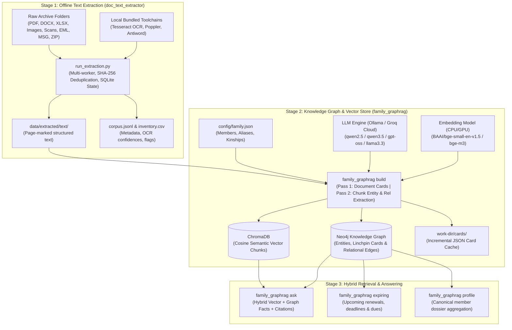

# Documents Knowledge Graph (Family GraphRAG)

An offline, privacy-first **Document Intelligence & Knowledge Graph** system tailored for personal and family archives. It processes government IDs, educational certificates, medical records, financial statements, insurance policies, warranties, legal agreements, receipts, and photos/videos — transforming raw files into a queryable **Neo4j Knowledge Graph** and **ChromaDB Vector Store** powered by local or cloud LLMs.

> 📖 **Need a complete file-by-file codebase guide?** See [repo_overview.md](file:///c:/Users/SakethBotte/Projects/Documents_Knowledge_Graph/repo_overview.md) for an exhaustive technical breakdown of every single file and architecture flow in this repository.  
> 🌐 **Interactive Visual Explainer:** Open [family_graphrag_explainer.html](file:///c:/Users/SakethBotte/Projects/Documents_Knowledge_Graph/family_graphrag_explainer.html) in any browser for an interactive UI walkthrough of the graph architecture.

---

## Architecture Overview



---

## Key Features

- **Privacy-First & Offline Ready:** Defaults to local LLMs (Ollama) and local embeddings (`SentenceTransformers` pinned to CPU). Automatic PII masking (Aadhaar, PAN, passports, emails, accounts) activates if remote LLMs (e.g., Groq) are explicitly enabled.
- **Universal Multi-Format Ingestion:** Extracts text from scanned/digital PDFs, Word (`.docx`, `.doc`), Excel (`.xlsx`, `.xls`, `.xlsb`), PowerPoint (`.pptx`, `.ppt`), RTF, OpenDocument (`.odt`, `.ods`), HTML/MHT, XML, Outlook emails (`.msg`, `.eml`), ZIP archives, and images (`.jpg`, `.png`, `.heic`, `.webp`).
- **Bundled Portable OCR:** Standalone local Tesseract (`eng`, `tel`, `hin`, etc.), Poppler, and Antiword binaries are auto-discovered without requiring system PATH modifications.
- **Smart SHA-256 Deduplication & Resume:** Processes duplicated documents and nested email attachments once, indexing results across copies and speeding up incremental re-runs.
- **Two-Pass Knowledge Graph (Family GraphRAG):**
  1. **Pass 1 (Document Cards):** Summarizes document category, issuer, holder, validity period, monetary amounts, and document numbers. Cached incrementally to disk.
  2. **Pass 2 (Chunk Entities & Relations):** Schema-constrained extraction of entities (Person, Organization, Asset, Event, Policy, etc.) and relationships across semantic chunks.
- **Family Roster & Alias Resolution:** Resolves informal references (*"Mom"*, *"Dad"*, *"Granny"*, nicknames) to canonical identities via `config/family.json`.
- **Hybrid Retrieval QA:** Combines dense cosine similarity vectors with Neo4j graph traversal and returns answers with verifiable source document citations.

---

## Repository Structure

```
Documents_Knowledge_Graph/
├── .vscode/
│   └── settings.json             # Workspace settings and Python interpreter config
├── config/
│   ├── family.json               # Family identities, aliases, and kinship definitions
│   └── settings.env              # Environment defaults (LLM endpoints, Neo4j, Embeddings)
├── data/                         # Private document storage (excluded from version control)
│   ├── extracted/                # Output from doc_text_extractor (text, corpus.jsonl, inventory.csv)
│   ├── graph/                    # Neo4j persistent data and logs
│   └── originals/                # (Optional) Source raw documents
├── docker-compose.yml            # Docker service for Neo4j 5 Community with APOC
├── family_graphrag_explainer.html# Interactive browser architecture walkthrough
├── local_installations/          # Bundled portable offline toolchains
│   ├── antiword/                 # Legacy Word (.doc) binary parser
│   ├── poppler-26.09.0/          # PDF rendering and utilities (pdftotext, pdftoppm)
│   └── Tesseract-OCR/            # Tesseract OCR engine and traineddata language models
├── README.md                     # Main user guide and instructions
├── repo_overview.md              # Exhaustive file-by-file technical documentation
├── requirements.txt              # Python package dependencies
└── src/
    ├── doc_text_extractor/       # Modular offline document extraction engine
    │   ├── core/                 # Detection, dispatcher, models, OCR preprocessing, text utilities
    │   ├── extractors/           # 20+ format-specific extractors (PDF, DOCX, EML, XLSX, ZIP, etc.)
    │   ├── extractor.py          # Unified entrypoint wrapper for extraction
    │   ├── ocr_config.py         # Auto-discovery for Tesseract, Poppler, and Antiword binaries
    │   └── run_extraction.py     # Multi-worker parallel runner CLI with SQLite state
    ├── family_graphrag/          # Modular GraphRAG package
    │   ├── cli.py                # Command-line interface (estimate, build, ask, expiring, profile)
    │   ├── config.py             # Dynamic configuration, paths, model options
    │   ├── family.py             # Family roster loading, alias mapping, and kinship injection
    │   ├── indexer.py            # Two-pass extraction pipeline, caching, and graph ingestion
    │   ├── llm.py                # LLM client wrapper, JSON parsing, and PII redaction
    │   ├── models.py             # Dataclasses: Doc, Segment, Chunk
    │   ├── parser.py             # Segment-aware chunking, page markers, and medium detection
    │   ├── prompts.py            # Few-shot prompts for cards, relations, and QA synthesis
    │   ├── schema.py             # Graph ontology, categories, relationship types, Cypher queries
    │   ├── search.py             # Hybrid vector + graph search, expiring dates, member profiles
    │   └── storage.py            # ChromaDB persistent client, SentenceTransformer, Neo4j driver
    ├── family_graphrag.py        # Backwards-compatible proxy script
    └── llm_instances.py          # Centralized LLM model factory (Groq Cloud & local Ollama)
```

---

## Prerequisites & Installation

### 1. Python Environment

Create and activate a Python 3.10+ virtual environment, then install dependencies:

```powershell
python -m venv venv
.\venv\Scripts\Activate.ps1
pip install -r requirements.txt
```

### 2. Neo4j Graph Database

Start Neo4j easily using the provided Docker Compose service:

```powershell
docker compose up -d
```

Or run Neo4j manually via Docker:

```powershell
docker run -d `
  -p 127.0.0.1:7474:7474 -p 127.0.0.1:7687:7687 `
  -e NEO4J_AUTH=neo4j/familygraphrag `
  -e NEO4J_PLUGINS='["apoc"]' `
  -v ${PWD}/data/graph/neo4j/data:/data `
  --name documents-neo4j neo4j:5-community
```

*Neo4j Browser UI is available at `http://localhost:7474` (Username: `neo4j`, Password: `familygraphrag`).*

### 3. LLM Setup (Local Ollama or Groq Cloud)

#### Option A: Local Ollama (Recommended for 100% Privacy)
Download [Ollama](https://ollama.com/) and pull your chosen model:

```powershell
ollama pull qwen2.5:14b
# or lightweight models:
ollama pull qwen3.5:9b
ollama pull qwen3.5:4b
```

#### Option B: Groq Cloud (High Speed / Large Models)
Set your `GROQ_API_KEY` in `config/settings.env` or shell environment:

```powershell
$env:GROQ_API_KEY="gsk_..."
$env:LLM_MODEL="qwen/qwen3.8-27b"  # or openai/gpt-oss-120b, openai/gpt-oss-20b
$env:ALLOW_REMOTE_LLM="1"
```

---

## Configuration

### 1. Family Identities (`config/family.json`)
Define canonical members, aliases, and known kinships so the graph links informal mentions to formal nodes:

```json
{
  "members": [
    {
      "name": "Elena Marlow",
      "relation_to_me": "self",
      "aliases": ["Elena", "Lena", "Lena Marlow"]
    },
    {
      "name": "Victor Marlow",
      "relation_to_me": "father",
      "aliases": ["Victor", "Dad", "Father"]
    },
    {
      "name": "Priya Marlow",
      "relation_to_me": "mother",
      "aliases": ["Priya", "Mom", "Mother"]
    }
  ],
  "relationships": [
    ["Victor Marlow", "SPOUSE_OF", "Priya Marlow"],
    ["Victor Marlow", "PARENT_OF", "Elena Marlow"],
    ["Priya Marlow", "PARENT_OF", "Elena Marlow"]
  ]
}
```

### 2. Environment Settings (`config/settings.env`)
Key configuration variables:

| Variable | Default | Purpose |
|:---|:---|:---|
| `LLM_BASE_URL` | `http://localhost:11434/v1` | OpenAI-compatible endpoint |
| `LLM_MODEL` | `qwen3.5:4b` | Active model identifier |
| `NEO4J_URI` | `bolt://localhost:7687` | Neo4j Bolt connection URI |
| `NEO4J_USER` | `neo4j` | Database username |
| `NEO4J_PASSWORD` | `familygraphrag` | Database password |
| `EMBED_MODEL` | `BAAI/bge-small-en-v1.5` | Embedding model (`BAAI/bge-m3` for multilingual) |
| `ALLOW_REMOTE_LLM` | `0` | Set `1` to enable cloud models (activates PII redaction) |
| `LLM_WORKERS` | `1` (local) / `4` (cloud) | Parallel extraction workers |

---

## End-to-End Usage Guide

### Step 1: Text Extraction (`doc_text_extractor`)

Extract clean, page-marked text from any folder of documents:

```powershell
# Run full extraction with parallel workers and multilingual OCR
.\venv\Scripts\python.exe src/doc_text_extractor/run_extraction.py "C:\Path\To\Vault" "data/extracted" --lang eng+tel+hin --workers 6

# Preview file counts and formats without extracting
.\venv\Scripts\python.exe src/doc_text_extractor/run_extraction.py "C:\Path\To\Vault" "data/extracted" --inventory-only
```

Outputs in `data/extracted/`:
- `text/`: Mirror of input folder with `.txt` page-separated files (`=== Page N ===`).
- `corpus.jsonl`: Document and attachment JSON records.
- `inventory.csv`: Complete extraction audit with OCR confidence and status flags.
- `state.sqlite`: Deduplication hash index for fast resumes.

---

### Step 2: Build the Knowledge Graph (`family_graphrag`)

You can run `family_graphrag` via either `python -m src.family_graphrag` or `python src/family_graphrag.py`.

#### 1. Estimate Token & Call Costs
```powershell
python -m src.family_graphrag estimate --src "data/extracted/text" --family "config/family.json"
```

#### 2. Pilot Build
Ingest the first 10 documents to test your setup:
```powershell
python -m src.family_graphrag build --src "data/extracted/text" --family "config/family.json" --limit 10
```

#### 3. Full Knowledge Graph Build
Ingest all documents with incremental caching and pruning of deleted files:
```powershell
python -m src.family_graphrag build `
  --src "data/extracted/text" `
  --family "config/family.json" `
  --workers 4 `
  --prune
```

*Custom work directory or Neo4j port can be specified on any command:*
```powershell
python -m src.family_graphrag build `
  --src "data/extracted/text" `
  --work-dir "graphrag_work" `
  --neo4j-uri "bolt://localhost:7687" `
  --workers 4
```

---

### Step 3: Querying the Graph

#### 1. Question Answering (`ask`)
Combines vector chunk retrieval with multi-hop graph facts to answer complex questions with citations:

```powershell
# General query
python -m src.family_graphrag ask "What does Priya's health insurance policy cover for cataract surgery?"

# Category-scoped query with graph facts printed
python -m src.family_graphrag ask "When does Elena's refrigerator warranty end?" --category warranty --show-facts

# Multi-hop query with increased retrieval breadth
python -m src.family_graphrag ask "Summarise the family home: who owns it, what is the loan balance, and what was paid in property tax?" --k 8
```

#### 2. Track Expirations & Deadlines (`expiring`)
Find upcoming policy renewals, warranty ends, utility dues, or lease maturities:

```powershell
# Upcoming within 90 days
python -m src.family_graphrag expiring --days 90

# Look back 30 days and ahead 180 days
python -m src.family_graphrag expiring --days 180 --past-days 30
```

#### 3. Member Profile Dossier (`profile`)
Compile all records, identity numbers, policies, educational credentials, and assets linked to a family member:

```powershell
python -m src.family_graphrag profile "Elena Marlow"
python -m src.family_graphrag profile "Dad"
```

---

## Testing & Verification

The repository includes a comprehensive 63-question verification suite covering family lineage, aliases, direct document retrieval, multi-hop reasoning, category filtering, expirations, OCR/media sidecars, and anti-hallucination tests.

View the full execution scorecard in [family_graphrag_test_report.md](file:///C:/Users/SakethBotte/.gemini/antigravity/brain/ff07acec-17d4-4efc-a245-5fdb89ff0212/family_graphrag_test_report.md) (100% success rate: 56 Passes, 7 Partials, 0 Failures).

---

## Security & Privacy Guidelines

- **Absolute Zero Leakage (Local Mode):** When running locally with Ollama, no data or embeddings ever leave your machine.
- **PII Guard (Remote Mode):** If `ALLOW_REMOTE_LLM=1` is enabled for cloud models (e.g. Groq), regular expressions automatically redact Aadhaar numbers, PANs, passports, and email addresses before prompt transmission.
- **Access Control:** Always configure a strong password for Neo4j and keep the database bound to localhost (`127.0.0.1`).
