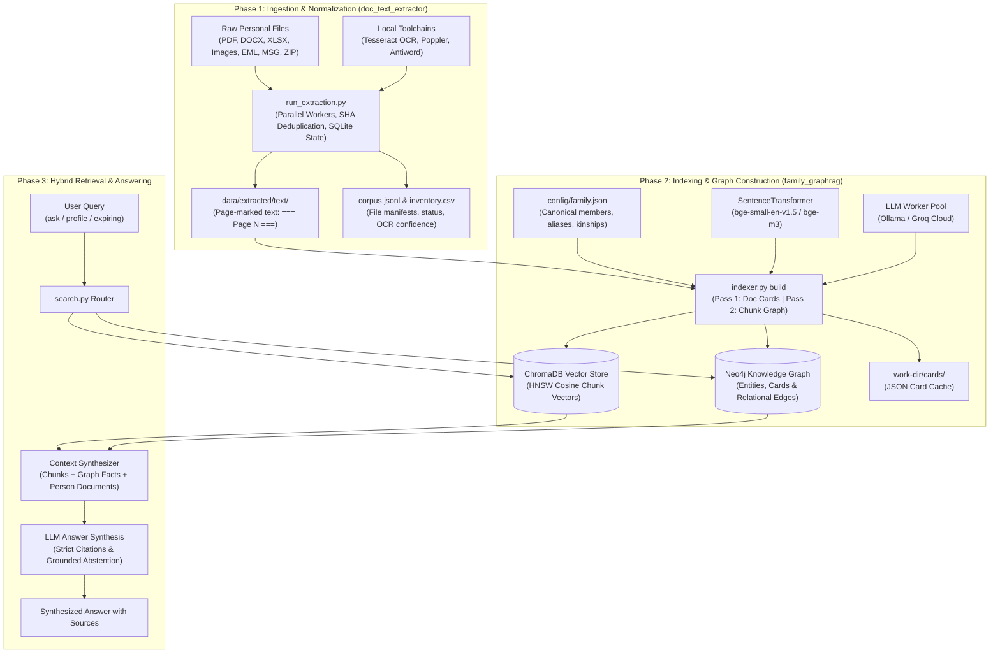
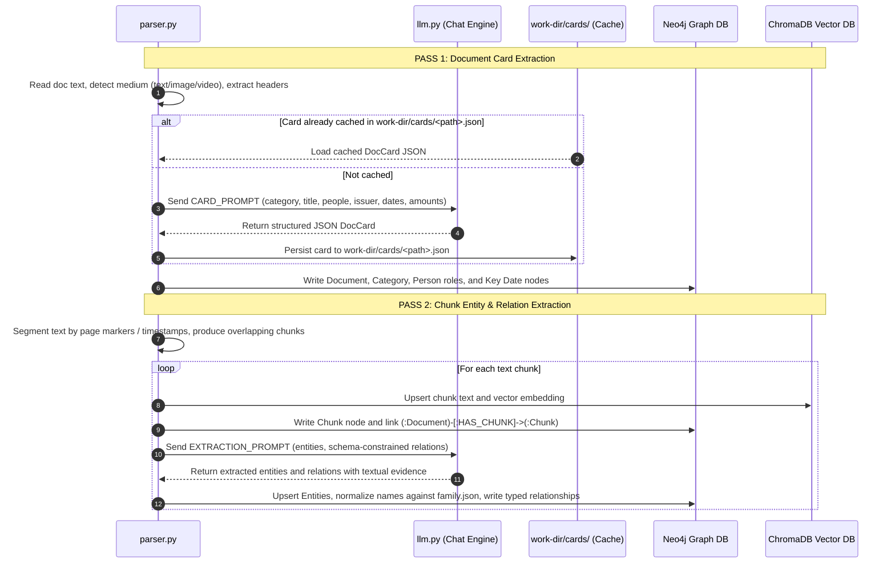
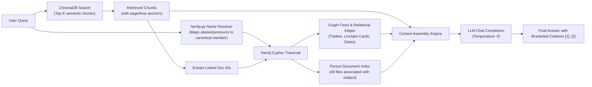
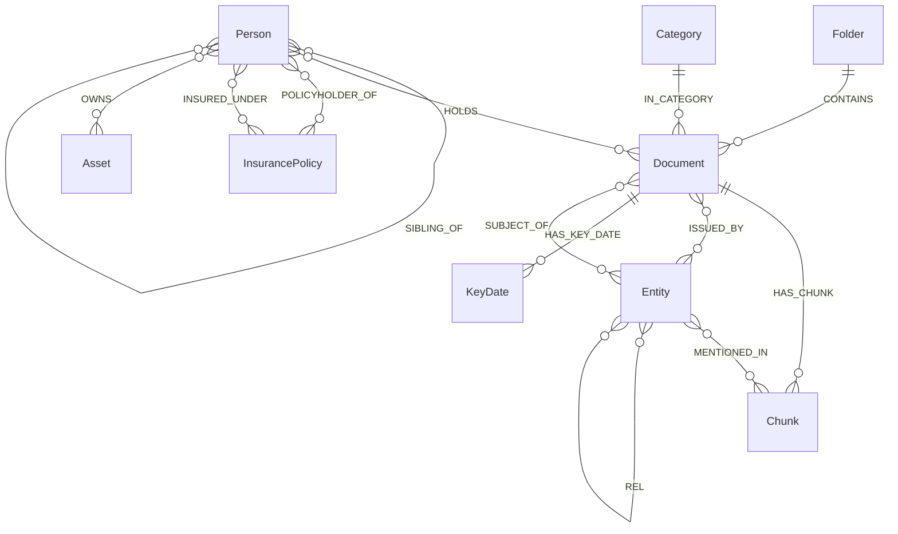

# Documents Knowledge Graph — Comprehensive Repository Overview

This document provides an exhaustive, end-to-end technical explanation of every single file, module, directory, and design pattern in the **Documents Knowledge Graph (Family GraphRAG)** repository.

---

## Table of Contents

1. [High-Level Architecture & System Design](#1-high-level-architecture--system-design)
   - [End-to-End System Flow](#end-to-end-system-flow)
   - [Two-Pass Knowledge Graph Construction](#two-pass-knowledge-graph-construction)
   - [Hybrid Retrieval & QA Engine](#hybrid-retrieval--qa-engine)
   - [Neo4j Graph Schema & Ontology](#neo4j-graph-schema--ontology)
2. [Complete File-by-File Inventory](#2-complete-file-by-file-inventory)
   - [Root Configuration & Environment Files](#root-configuration--environment-files)
   - [Configuration Directory (`config/`)](#configuration-directory-config)
   - [VSCode Settings (`.vscode/`)](#vscode-settings-vscode)
   - [Top-Level Python Scripts (`src/`)](#top-level-python-scripts-src)
   - [Family GraphRAG Engine (`src/family_graphrag/`)](#family-graphrag-engine-srcfamily_graphrag)
   - [Document Ingestion Engine (`src/doc_text_extractor/`)](#document-ingestion-engine-srcdoc_text_extractor)
   - [Ingestion Core Utilities (`src/doc_text_extractor/core/`)](#ingestion-core-utilities-srcdoc_text_extractorcore)
   - [Specialized Format Extractors (`src/doc_text_extractor/extractors/`)](#specialized-format-extractors-srcdoc_text_extractorextractors)
   - [Bundled Portable Toolchains (`local_installations/`)](#bundled-portable-toolchains-local_installations)
   - [Working Directories & State Storage (`graphrag_work/` & `data/`)](#working-directories--state-storage-graphrag_work--data)
3. [Cross-Cutting Architectural Patterns](#3-cross-cutting-architectural-patterns)
   - [Privacy Guard & PII Redaction](#privacy-guard--pii-redaction)
   - [SHA-256 Deduplication & Resume Cache](#sha-256-deduplication--resume-cache)
   - [Fallback Wrappers & Zero-Dependency Portability](#fallback-wrappers--zero-dependency-portability)

---

## 1. High-Level Architecture & System Design

The system solves the problem of personal and family document archives: unstructured, mixed-media files (scanned PDFs, Word docs, spreadsheets, mobile phone photos of receipts, video transcripts, and emails) containing critical life data (identities, medical episodes, insurance terms, claims, warranties, property deeds, loans).

It bridges the gap between raw unstructured files and structured natural-language discovery using a **hybrid architecture** combining:
1. **Deterministic Text Extraction & OCR**
2. **Dense Vector Embeddings (ChromaDB)**
3. **Entity-Relationship Knowledge Graph (Neo4j)**
4. **Large Language Models (Local Ollama / Groq Cloud)**

---

### Two-Pass Knowledge Graph Construction

A key innovation of this codebase is the **Two-Pass Knowledge Graph Build Pipeline**, which separates document-level metadata from localized semantic facts:

---

### Hybrid Retrieval & QA Engine

Standard vector RAG fails on multi-hop questions (e.g., *"Did Priya's cataract claim match her health plan co-pay and per-eye limit?"*). `search.py` solves this by fusing **vector proximity** with **graph hops**:

---

### Neo4j Graph Schema & Ontology

The Neo4j database uses a strictly defined schema that prevents graph bloat while preserving deep relational connections:

---

## 2. Complete File-by-File Inventory

Every file in the repository is documented below with its exact purpose, components, inputs/outputs, and role.

---

### Root Configuration & Environment Files

#### 1. [`.gitignore`](file:///c:/Users/SakethBotte/Projects/Documents_Knowledge_Graph/.gitignore)
- **Purpose:** Specifies intentionally untracked files that Git should ignore.
- **Key Contents:** Ignores Python bytecode (`__pycache__/`, `*.pyc`), virtual environments (`venv/`, `.env/`), local document directories (`data/`, `graphrag_work/`), IDE caches (`.idea/`, `.vscode/`), and runtime logs (`extract.log`).
- **Role:** Ensures zero personal files, sensitive data, or large binaries are accidentally committed to Git.

#### 2. [`docker-compose.yml`](file:///c:/Users/SakethBotte/Projects/Documents_Knowledge_Graph/docker-compose.yml)
- **Purpose:** Orchestrates the local Neo4j graph database container.
- **Service Name:** `neo4j` using image `neo4j:5-community`.
- **Ports:**
  - `7474`: Neo4j Browser Web UI (`http://localhost:7474`)
  - `7687`: Bolt binary protocol port for Python driver connections
- **Environment & Plugins:**
  - `NEO4J_AUTH=neo4j/familygraphrag`: Sets default credentials.
  - `NEO4J_PLUGINS=["apoc"]`: Pre-installs Awesome Procedures on Cypher (APOC) for complex graph algorithms.
  - Memory heap limits: Initial 512MB, Max 2GB, Page cache 1GB.
- **Volume Mounts:** Binds `./data/graph/neo4j/data`, `./data/graph/neo4j/logs`, and `./data/graph/neo4j/import` to preserve database state across restarts.

#### 3. [`family_graphrag_explainer.html`](file:///c:/Users/SakethBotte/Projects/Documents_Knowledge_Graph/family_graphrag_explainer.html)
- **Purpose:** Standalone, interactive HTML/Tailwind CSS dashboard for visually exploring the architecture of the Family GraphRAG system.
- **Features:** Includes tabbed views for Pipeline Overview, Two-Pass LLM Ingestion, Cypher Schema, Hybrid Retrieval Flow, and Interactive Code Walkthroughs.
- **Role:** Acts as an architectural visualizer that users can open directly in any web browser without starting a server.

#### 4. [`README.md`](file:///c:/Users/SakethBotte/Projects/Documents_Knowledge_Graph/README.md)
- **Purpose:** Primary user-facing documentation and quickstart guide.
- **Contents:** Explains project philosophy, architecture diagrams, prerequisites, installation steps, configuration guides (`family.json`, `settings.env`), CLI commands (`estimate`, `build`, `ask`, `expiring`, `profile`), and security policies.

#### 5. [`repo_overview.md`](file:///c:/Users/SakethBotte/Projects/Documents_Knowledge_Graph/repo_overview.md)
- **Purpose:** *This document.* Complete, technical, file-by-file encyclopedia of the entire repository.

#### 6. [`requirements.txt`](file:///c:/Users/SakethBotte/Projects/Documents_Knowledge_Graph/requirements.txt)
- **Purpose:** Pins exact versions of all Python dependencies required by the system.
- **Key Libraries:**
  - `chromadb` (1.5.9): Embedded vector database for chunk embeddings.
  - `sentence-transformers` & `huggingface-hub`: Dense embedding model inference (`BAAI/bge-small-en-v1.5`).
  - `neo4j` (6.4.1): Official Python driver for Neo4j Bolt graph queries.
  - `openai` (3.46.0): Native client for Ollama and Groq chat completions.
  - `pymupdf` & `pymupdf4llm`: High-performance PDF parsing and markdown extraction.
  - `pytesseract` & `pillow`: Local OCR execution and image processing.
  - `python-docx`, `openpyxl`, `python-pptx`: Modern Microsoft Office format parsers.
  - `extract-msg`: Outlook `.msg` parsing.
  - `python-dotenv`: Environment variable loader.

---

### Configuration Directory (`config/`)

#### 7. [`config/family.json`](file:///c:/Users/SakethBotte/Projects/Documents_Knowledge_Graph/config/family.json)
- **Purpose:** Defines the family's canonical members, known aliases, and kinship structure.
- **Structure:**
  - `members`: List of objects containing `name` (canonical identity), `relation_to_me` (`self`, `father`, `mother`, `spouse`, `child`, `sibling`, `grandmother`), and `aliases` (list of nicknames, alternate spellings, or colloquial terms like `"Dad"`, `"Mom"`, `"Granny"`).
  - `relationships`: Directed kinship triplets (e.g. `["Victor Marlow", "PARENT_OF", "Elena Marlow"]`, `["Victor Marlow", "SPOUSE_OF", "Priya Marlow"]`).
- **Role:** Seeded into Neo4j at build time to anchor the family tree and used by `normalize_name()` to map ambiguous document mentions to canonical entities.

#### 8. [`config/settings.env`](file:///c:/Users/SakethBotte/Projects/Documents_Knowledge_Graph/config/settings.env)
- **Purpose:** Centralized environment configuration file defining defaults for the entire application.
- **Key Parameters:**
  - `LLM_BASE_URL`: OpenAI-compatible endpoint URL (`http://localhost:11434/v1` for Ollama or `https://api.groq.com/openai/v1` for Groq).
  - `LLM_MODEL`: Active model name (e.g., `qwen3.5:4b`, `qwen/qwen3.8-27b`, `openai/gpt-oss-120b`).
  - `GROQ_API_KEY`: API authentication token for Groq Cloud.
  - `NEO4J_URI`, `NEO4J_USER`, `NEO4J_PASSWORD`: Neo4j connection parameters (`bolt://localhost:7687`).
  - `EMBED_MODEL`: HuggingFace embedding model ID (`BAAI/bge-small-en-v1.5`).
  - `ALLOW_REMOTE_LLM`: Flag (`0` or `1`) controlling whether non-local endpoints are allowed (activates automatic PII masking).
  - `LLM_WORKERS`: Concurrency level for extraction passes.

---

### VSCode Settings (`.vscode/`)

#### 9. [`.vscode/settings.json`](file:///c:/Users/SakethBotte/Projects/Documents_Knowledge_Graph/.vscode/settings.json)
- **Purpose:** Visual Studio Code workspace configuration.
- **Role:** Sets the default Python interpreter to `venv\Scripts\python.exe` and configures editor linting, formatting, and file exclusion rules for a seamless developer experience.

---

### Top-Level Python Scripts (`src/`)

#### 10. [`src/family_graphrag.py`](file:///c:/Users/SakethBotte/Projects/Documents_Knowledge_Graph/src/family_graphrag.py)
- **Purpose:** Backwards-compatible proxy script for the modular `family_graphrag` package.
- **Mechanics:** Adds project root and `src/` to `sys.path` and re-exports primary symbols (`main`, `build`, `ask`, `expiring`, `profile`, `estimate`, `Doc`, `Segment`, `Chunk`, `chroma_collection`, `neo4j_driver`).
- **Role:** Allows running `python src/family_graphrag.py <command>` or importing directly from `src.family_graphrag` without breaking legacy workflows.

#### 11. [`src/llm_instances.py`](file:///c:/Users/SakethBotte/Projects/Documents_Knowledge_Graph/src/llm_instances.py)
- **Purpose:** Centralized model factory, registry, and fallback abstraction layer for all LLM calls across the repository.
- **Key Classes & Functions:**
  - `ChatOpenAI`: A zero-dependency, lightweight fallback wrapper around `openai.OpenAI` that mimics the `langchain_openai.ChatOpenAI` interface (supporting `.invoke()` and message dicts/tuples) when `langchain_openai` is not installed.
  - `LLM_INSTANCES`: Global dictionary caching initialized model instances.
  - `create_ollama_instance(model_name, temperature)`: Helper instantiating local Ollama wrappers.
  - `get_llm(model_key)`: Unified accessor returning an initialized LLM client for any registered model key or alias (`GROQ_LLAMA_3_3_70B`, `GROQ_GPT_OSS_120B`, `OLLAMA_QWEN_3_5_9B`, `OLLAMA_QWEN_3_5_4B`, etc.).
  - `discover_local_ollama_models()`: Probes the local Ollama daemon (`http://localhost:11434/api/tags`) via HTTP to dynamically register all downloaded models.
- **Role:** Prevents duplicate LLM client initialization and guarantees resilience regardless of whether LangChain is installed in the virtual environment.

---

### Family GraphRAG Engine (`src/family_graphrag/`)

This package houses the core GraphRAG pipeline, refactored into focused, single-responsibility modules.

#### 12. [`src/family_graphrag/__init__.py`](file:///c:/Users/SakethBotte/Projects/Documents_Knowledge_Graph/src/family_graphrag/__init__.py)
- **Purpose:** Package initializer exposing the public API.
- **Exports:** `main`, `build`, `ask`, `expiring`, `profile`, `estimate`, `Doc`, `Segment`, `Chunk`, `process_doc`, `save_card`, `chroma_collection`, `embed`, `neo4j_driver`.

#### 13. [`src/family_graphrag/__main__.py`](file:///c:/Users/SakethBotte/Projects/Documents_Knowledge_Graph/src/family_graphrag/__main__.py)
- **Purpose:** Execution entrypoint when invoking `python -m src.family_graphrag`.
- **Role:** Forwards command-line arguments to `cli.main()`.

#### 14. [`src/family_graphrag/cli.py`](file:///c:/Users/SakethBotte/Projects/Documents_Knowledge_Graph/src/family_graphrag/cli.py)
- **Purpose:** Command-line interface definition and argument parser.
- **Subcommands:**
  - `estimate`: Calculates document count, chunk count, estimated tokens, and call costs before running LLMs.
  - `build`: Runs two-pass indexing into ChromaDB and Neo4j (`--workers`, `--limit`, `--only`, `--prune`).
  - `ask`: Answers questions using hybrid retrieval (`--k`, `--category`, `--show-facts`).
  - `expiring`: Surfaces upcoming deadlines, renewal dates, and utility dues (`--days`, `--past-days`).
  - `profile`: Compiles all facts, IDs, policies, and records for a specific person.
- **Dynamic Configuration Flags:** Supports `--work-dir`, `--neo4j-uri`, `--neo4j-database`, and `--family` across all subcommands.

#### 15. [`src/family_graphrag/config.py`](file:///c:/Users/SakethBotte/Projects/Documents_Knowledge_Graph/src/family_graphrag/config.py)
- **Purpose:** Configuration manager loading environment variables from `config/settings.env` and `.env`.
- **Key Functions:**
  - `set_work_dir(path)`: Dynamically reconfigures the working directory for ChromaDB and card cache.
  - `set_neo4j_uri(uri)`: Updates the Neo4j Bolt connection endpoint.
  - `set_neo4j_database(name)`: Sets target Neo4j database.
- **Constants:** Defines chunking thresholds (`CHUNK_CHARS=1600`, `CHUNK_OVERLAP=250`), default currency (`INR`), date format hints, and embedding prefixes.

#### 16. [`src/family_graphrag/family.py`](file:///c:/Users/SakethBotte/Projects/Documents_Knowledge_Graph/src/family_graphrag/family.py)
- **Purpose:** Family roster manager, alias resolver, and kinship graph injector.
- **Key Functions:**
  - `load_family(path)`: Reads `family.json`, populates canonical name maps, and builds alias dictionaries.
  - `_norm(name)`: Aggressively normalizes entity strings (stripping honorifics like *Mr, Mrs, Dr, Smt, Shri* and corporate suffixes like *Pvt Ltd, Inc, LLC*).
  - `normalize_name(name)`: Maps any recognized alias or variant to its canonical family member key.
  - `display_name(key, fallback)`: Returns canonical display name.
  - `resolve_family(query)`: Detects family mentions or kinship terms (*"Dad"*, *"Mom"*, *"my parents"*) in natural language queries.
  - `seed_family(session)`: Cypher transaction writing pre-defined family members and relationships (`PARENT_OF`, `SPOUSE_OF`, etc.) into Neo4j.

#### 17. [`src/family_graphrag/indexer.py`](file:///c:/Users/SakethBotte/Projects/Documents_Knowledge_Graph/src/family_graphrag/indexer.py)
- **Purpose:** Orchestrates the Two-Pass ingestion pipeline and database synchronization.
- **Key Functions:**
  - `build(src, only, limit, workers, prune)`: Main build loop. Iterates documents, checks hash caches, coordinates parallel worker threads, and prunes deleted records if requested.
  - `process_doc(doc, dry_run)`: Executes Pass 1 (Card Extraction via `CARD_PROMPT`) and Pass 2 (Chunk Extraction via `EXTRACTION_PROMPT`), writing nodes and edges to Neo4j and vector embeddings to ChromaDB.
  - `save_card(doc, card)`: Serializes extracted document cards as structured JSON into `<work-dir>/cards/<rel_path>.json`, preserving directory structure for lightning-fast incremental builds.
  - `purge_doc(session, doc_id)`: Removes all graph nodes, chunks, and relationships associated with a document if it was modified or deleted.

#### 18. [`src/family_graphrag/llm.py`](file:///c:/Users/SakethBotte/Projects/Documents_Knowledge_Graph/src/family_graphrag/llm.py)
- **Purpose:** LLM client wrapper, chat execution handler, JSON extractor, and PII guard.
- **Key Functions:**
  - `llm_client()`: Returns an initialized `openai.OpenAI` client pointing to `LLM_BASE_URL`.
  - `chat(prompt, json_mode)`: Executes completion with exponential backoff retry. Automatically attempts strict JSON mode first, with regex fallback parsing if the provider does not support JSON schema.
  - `redact(text)`: Regular-expression PII mask replacing Aadhaar (12 digits), PAN (10 chars), passport numbers, bank accounts, and emails with masked tokens (e.g. `[REDACTED-1234]`) whenever `ALLOW_REMOTE_LLM=1`.
  - `parse_json_loose(text)`: Robust JSON extractor capable of extracting valid JSON objects wrapped inside markdown code fences or conversational prose.

#### 19. [`src/family_graphrag/models.py`](file:///c:/Users/SakethBotte/Projects/Documents_Knowledge_Graph/src/family_graphrag/models.py)
- **Purpose:** Fundamental dataclass containers.
- **Classes:**
  - `Segment`: Represents a single page, video timestamp segment (`00:01:15`), or document section with a textual label.
  - `Doc`: Represents a parsed vault document with `rel_path`, `display_path`, `medium` (`text|image|video`), `segments`, SHA-1 `content_hash`, and optional email metadata dictionary.
  - `Chunk`: Represents an overlapping text chunk with unique `chunk_id`, parent `doc_id`, location breadcrumbs (`locs`), and chunk text.

#### 20. [`src/family_graphrag/parser.py`](file:///c:/Users/SakethBotte/Projects/Documents_Knowledge_Graph/src/family_graphrag/parser.py)
- **Purpose:** Document reading, segment parsing, medium detection, and chunk generation.
- **Key Functions:**
  - `guess_medium(name, headers, body)`: Classifies file as `text`, `image` (photo/scan), or `video` based on headers, extension, or preamble.
  - `split_segments(body, medium)`: Parses page break markers (`=== Page N ===`), video timestamps (`[00:01:15]`), or form feeds.
  - `chunk_doc(doc)`: Splits segments into overlapping semantic chunks of ~1,600 characters with 250-character overlap, attaching location citations (`p. 1-2`, `00:00:15`).
  - `iter_docs(src, only)`: File iterator reading text vault files and yielding structured `Doc` instances.

#### 21. [`src/family_graphrag/prompts.py`](file:///c:/Users/SakethBotte/Projects/Documents_Knowledge_Graph/src/family_graphrag/prompts.py)
- **Purpose:** Centralized repository for all system prompt templates.
- **Prompts:**
  - `CARD_PROMPT`: Directs the LLM to extract document category, title, summary, issuer, document number, validity dates, monetary amounts, key deadline dates, and person roles.
  - `EXTRACTION_PROMPT`: Few-shot prompt guiding chunk-level entity and relationship extraction constrained strictly to allowed ontologies.
  - `ANSWER_PROMPT`: Synthesis prompt instructing the LLM to answer user questions using provided chunks and graph facts, requiring bracketed citations (`[1]`) and strict abstention if facts are absent.

#### 22. [`src/family_graphrag/README.md`](file:///c:/Users/SakethBotte/Projects/Documents_Knowledge_Graph/src/family_graphrag/README.md)
- **Purpose:** Package-internal documentation explaining the modular directory structure and module responsibilities.

#### 23. [`src/family_graphrag/schema.py`](file:///c:/Users/SakethBotte/Projects/Documents_Knowledge_Graph/src/family_graphrag/schema.py)
- **Purpose:** Formal ontology definitions, category taxonomies, and Cypher query constants.
- **Key Constants:**
  - `DOC_CATEGORIES`: 40+ allowed document types (e.g. `birth_certificate`, `health_insurance`, `warranty`, `property_document`, `tax_document`).
  - `ENTITY_TYPES`: 13 strict entity categories (`Person`, `Organization`, `Record`, `InsurancePolicy`, `Product`, `Service`, `Asset`, `MedicalCondition`, `Medication`, `Procedure`, `Qualification`, `Event`, `Location`).
  - `RELATION_TYPES`: Strict relationship types across domains (civil, health, financial, legal, familial).
  - Cypher Statements: `SCHEMA_CYPHER` (constraints and indexes), `WRITE_DOC`, `WRITE_CARD`, `WRITE_CHUNK`, `FACTS_CYPHER`, `PERSON_DOCS_CYPHER`.

#### 24. [`src/family_graphrag/search.py`](file:///c:/Users/SakethBotte/Projects/Documents_Knowledge_Graph/src/family_graphrag/search.py)
- **Purpose:** Hybrid retrieval, query routing, question answering, and profile generation.
- **Key Functions:**
  - `ask(question, k, category, show)`: Executes hybrid vector + graph retrieval, gathers graph facts and person-document links, renders the context block, prompts the LLM for synthesis, and prints answer with citations.
  - `expiring(days, past_days)`: Queries Neo4j for upcoming key dates, policy maturities, warranty deadlines, and utility dues.
  - `profile(name)`: Resolves a person's name or alias and displays a comprehensive dossier of all related documents, policy numbers, assets, and family relations.
  - `estimate(src, only, limit)`: Scans the archive, computes chunk counts, and calculates token estimates for cost planning.

#### 25. [`src/family_graphrag/storage.py`](file:///c:/Users/SakethBotte/Projects/Documents_Knowledge_Graph/src/family_graphrag/storage.py)
- **Purpose:** Low-level database drivers for ChromaDB, SentenceTransformers, and Neo4j.
- **Key Functions:**
  - `embed(texts)`: Generates dense L2-normalized embeddings using `SentenceTransformer` pinned to CPU (with offline local file preference).
  - `chroma_collection()`: Returns the persistent ChromaDB collection (`family_chunks`) using cosine distance.
  - `neo4j_driver()`: Creates a thread-safe Neo4j driver with silenced GQL status notifications and dynamic database routing.

---

### Document Ingestion Engine (`src/doc_text_extractor/`)

This package performs deterministic, 100% offline text extraction across virtually any document format.

#### 26. [`src/doc_text_extractor/__init__.py`](file:///c:/Users/SakethBotte/Projects/Documents_Knowledge_Graph/src/doc_text_extractor/__init__.py)
- **Purpose:** Package init exposing top-level extraction utilities.

#### 27. [`src/doc_text_extractor/README.md`](file:///c:/Users/SakethBotte/Projects/Documents_Knowledge_Graph/src/doc_text_extractor/README.md)
- **Purpose:** Comprehensive documentation for the text extraction subsystem, detailing supported formats, OCR pipeline, and command options.

#### 28. [`src/doc_text_extractor/extractor.py`](file:///c:/Users/SakethBotte/Projects/Documents_Knowledge_Graph/src/doc_text_extractor/extractor.py)
- **Purpose:** Unified facade and entrypoint for document extraction.
- **Key Functions:**
  - `extract_document(path, workdir, options)`: Detects format and dispatches to the correct specialized extractor, returning a structured `Result` object containing pages, sections, attachments, and status flags.
  - `extract_text(path, max_chars)`: Backwards-compatible convenience function returning pages joined with `[PAGE BREAK]`.

#### 29. [`src/doc_text_extractor/ocr_config.py`](file:///c:/Users/SakethBotte/Projects/Documents_Knowledge_Graph/src/doc_text_extractor/ocr_config.py)
- **Purpose:** Dynamic auto-discovery for local binary toolchains.
- **Mechanics:** Scans bundled directories (`local_installations/`), system PATH, and standard Windows directories for `tesseract.exe`, `pdftotext.exe`, `pdftoppm.exe`, `antiword.exe`, and LibreOffice (`soffice.exe`).
- **Role:** Eliminates manual PATH configuration on Windows machines.

#### 30. [`src/doc_text_extractor/run_extraction.py`](file:///c:/Users/SakethBotte/Projects/Documents_Knowledge_Graph/src/doc_text_extractor/run_extraction.py)
- **Purpose:** Multi-worker CLI runner for large document vaults.
- **Key Features:**
  - Multi-process parallel execution (`--workers`).
  - SQLite state database (`state.sqlite`) for tracking SHA-256 hashes, skipping unchanged files, and deduplicating identical attachments across emails and archives.
  - Generates `corpus.jsonl` (line-delimited document records), `inventory.csv` (audit sheet with OCR confidences and flags), and `summary.json`.

---

### Ingestion Core Utilities (`src/doc_text_extractor/core/`)

#### 31. [`src/doc_text_extractor/core/__init__.py`](file:///c:/Users/SakethBotte/Projects/Documents_Knowledge_Graph/src/doc_text_extractor/core/__init__.py)
- **Purpose:** Core package initializer.

#### 32. [`src/doc_text_extractor/core/detection.py`](file:///c:/Users/SakethBotte/Projects/Documents_Knowledge_Graph/src/doc_text_extractor/core/detection.py)
- **Purpose:** Robust file format detection and junk filtering.
- **Mechanics:** Inspects file extensions, magic bytes (PDF header `%PDF`, ZIP header `PK`, OLE compound header `\xD0\xCF\x11\xE0`), OLE stream kinds, and filters out system junk (`Thumbs.db`, `.DS_Store`, temporary files `~$...`).

#### 33. [`src/doc_text_extractor/core/dispatcher.py`](file:///c:/Users/SakethBotte/Projects/Documents_Knowledge_Graph/src/doc_text_extractor/core/dispatcher.py)
- **Purpose:** Routes detected document formats to their respective specialized extractors.
- **Role:** Maps detected types (`pdf`, `docx`, `xlsx`, `eml`, `image`, etc.) to the handler functions and manages error handling (corrupted files, password-protected encryption).

#### 34. [`src/doc_text_extractor/core/external_tools.py`](file:///c:/Users/SakethBotte/Projects/Documents_Knowledge_Graph/src/doc_text_extractor/core/external_tools.py)
- **Purpose:** Safe subprocess execution and LibreOffice conversion fallback.
- **Key Functions:**
  - `_run(cmd, ...)`: Subprocess execution with strict timeouts and output capture.
  - `convert_with_soffice(src_path, target_format, out_dir)`: Headless LibreOffice conversion wrapper used when native parsers cannot handle proprietary legacy formats.

#### 35. [`src/doc_text_extractor/core/models.py`](file:///c:/Users/SakethBotte/Projects/Documents_Knowledge_Graph/src/doc_text_extractor/core/models.py)
- **Purpose:** Dataclasses and exceptions for text extraction.
- **Classes:**
  - `Options`: Configuration options (OCR languages, max image dimension, spreadsheet row limits).
  - `Page`: Single page container with page number, text, extraction method (`native`, `ocr`, `antiword`), and OCR confidence score.
  - `Result`: Container for extraction results including status (`ok`, `empty`, `encrypted`, `error`), pages, extra sections (headers/footers/footnotes), child attachments, and warning flags.

#### 36. [`src/doc_text_extractor/core/ocr.py`](file:///c:/Users/SakethBotte/Projects/Documents_Knowledge_Graph/src/doc_text_extractor/core/ocr.py)
- **Purpose:** Advanced image preprocessing and Tesseract OCR invocation.
- **Mechanics:** Implements automated deskewing (calculating Hough skew angles), Otsu binarization, median despeckling, orientation detection, and multi-variant threshold fallbacks to maximize OCR legibility on poor-quality scans.

#### 37. [`src/doc_text_extractor/core/text_utils.py`](file:///c:/Users/SakethBotte/Projects/Documents_Knowledge_Graph/src/doc_text_extractor/core/text_utils.py)
- **Purpose:** Text normalization and quality heuristics.
- **Mechanics:** Cleans control characters, normalizes Unicode whitespace, computes garbage character ratios, evaluates English/vernacular word scores, safely decodes unknown byte streams, and generates sanitized file names.

---

### Specialized Format Extractors (`src/doc_text_extractor/extractors/`)

#### 38. [`src/doc_text_extractor/extractors/__init__.py`](file:///c:/Users/SakethBotte/Projects/Documents_Knowledge_Graph/src/doc_text_extractor/extractors/__init__.py)
- **Purpose:** Extractors package initializer.

#### 39. [`src/doc_text_extractor/extractors/_attachment_common.py`](file:///c:/Users/SakethBotte/Projects/Documents_Knowledge_Graph/src/doc_text_extractor/extractors/_attachment_common.py)
- **Purpose:** Common attachment filtering logic.
- **Mechanics:** Discards small decorative email signatures, bullet icons, and thumbnail images (`_is_small_inline_image`) while preserving real attached documents and receipts.

#### 40. [`src/doc_text_extractor/extractors/_spreadsheet_common.py`](file:///c:/Users/SakethBotte/Projects/Documents_Knowledge_Graph/src/doc_text_extractor/extractors/_spreadsheet_common.py)
- **Purpose:** Shared spreadsheet cell and tabular formatting.
- **Mechanics:** Formats dates, percentages, floating point values, and formats rows into clean tab-delimited or markdown-style tables.

#### 41. [`src/doc_text_extractor/extractors/damaged_zip_extractor.py`](file:///c:/Users/SakethBotte/Projects/Documents_Knowledge_Graph/src/doc_text_extractor/extractors/damaged_zip_extractor.py)
- **Purpose:** Resilient salvage extractor for corrupted Office XML (`.docx`, `.xlsx`, `.pptx`) or truncated ZIP files.
- **Mechanics:** Bypasses broken central directory headers and scans raw byte streams for compressed XML fragments to extract readable text.

#### 42. [`src/doc_text_extractor/extractors/doc_extractor.py`](file:///c:/Users/SakethBotte/Projects/Documents_Knowledge_Graph/src/doc_text_extractor/extractors/doc_extractor.py)
- **Purpose:** Extracts text from legacy Microsoft Word 97-2003 binary `.doc` files using the bundled `antiword` utility or LibreOffice fallback.

#### 43. [`src/doc_text_extractor/extractors/docx_extractor.py`](file:///c:/Users/SakethBotte/Projects/Documents_Knowledge_Graph/src/doc_text_extractor/extractors/docx_extractor.py)
- **Purpose:** Modern Word `.docx` parser using `python-docx` and XML parsing.
- **Capabilities:** Extracts body paragraphs, tables, headers, footers, footnotes, tracked changes, and embedded image attachments.

#### 44. [`src/doc_text_extractor/extractors/eml_extractor.py`](file:///c:/Users/SakethBotte/Projects/Documents_Knowledge_Graph/src/doc_text_extractor/extractors/eml_extractor.py)
- **Purpose:** RFC 822 `.eml` email message parser.
- **Capabilities:** Extracts headers (`Subject`, `From`, `To`, `Cc`, `Date`), plaintext or HTML bodies, and unwraps attached files into the extraction pipeline.

#### 45. [`src/doc_text_extractor/extractors/html_extractor.py`](file:///c:/Users/SakethBotte/Projects/Documents_Knowledge_Graph/src/doc_text_extractor/extractors/html_extractor.py)
- **Purpose:** Parses standalone `.html` / `.htm` web documents and saved receipts using BeautifulSoup.

#### 46. [`src/doc_text_extractor/extractors/image_extractor.py`](file:///c:/Users/SakethBotte/Projects/Documents_Knowledge_Graph/src/doc_text_extractor/extractors/image_extractor.py)
- **Purpose:** OCR extractor for scanned image files (`.png`, `.jpg`, `.jpeg`, `.heic`, `.webp`, `.tiff`).
- **Mechanics:** Opens images via Pillow/pillow-heif, runs preprocessing (deskew, binarize), and calls Tesseract OCR.

#### 47. [`src/doc_text_extractor/extractors/mht_extractor.py`](file:///c:/Users/SakethBotte/Projects/Documents_Knowledge_Graph/src/doc_text_extractor/extractors/mht_extractor.py)
- **Purpose:** Parses MIME HTML (`.mht`, `.mhtml`) archives, extracting HTML/text parts and unpacked media attachments.

#### 48. [`src/doc_text_extractor/extractors/msg_extractor.py`](file:///c:/Users/SakethBotte/Projects/Documents_Knowledge_Graph/src/doc_text_extractor/extractors/msg_extractor.py)
- **Purpose:** Microsoft Outlook `.msg` file parser using `extract-msg`.
- **Capabilities:** Extracts metadata, email body, RTF bodies, and embedded child attachments.

#### 49. [`src/doc_text_extractor/extractors/odf_extractor.py`](file:///c:/Users/SakethBotte/Projects/Documents_Knowledge_Graph/src/doc_text_extractor/extractors/odf_extractor.py)
- **Purpose:** OpenDocument parser for OpenOffice/LibreOffice files (`.odt`, `.ods`, `.odp`) via internal XML traversal (`content.xml`).

#### 50. [`src/doc_text_extractor/extractors/pdf_extractor.py`](file:///c:/Users/SakethBotte/Projects/Documents_Knowledge_Graph/src/doc_text_extractor/extractors/pdf_extractor.py)
- **Purpose:** High-performance, dual-mode PDF extractor.
- **Mechanics:** Attempts native digital text extraction via PyMuPDF (`fitz`). If a page has little or no selectable text (scanned page), it automatically renders the page at 300 DPI and performs OCR using Tesseract and Poppler.

#### 51. [`src/doc_text_extractor/extractors/ppt_extractor.py`](file:///c:/Users/SakethBotte/Projects/Documents_Knowledge_Graph/src/doc_text_extractor/extractors/ppt_extractor.py)
- **Purpose:** Legacy PowerPoint 97-2003 `.ppt` extractor using OLE stream inspection and LibreOffice fallback.

#### 52. [`src/doc_text_extractor/extractors/pptx_extractor.py`](file:///c:/Users/SakethBotte/Projects/Documents_Knowledge_Graph/src/doc_text_extractor/extractors/pptx_extractor.py)
- **Purpose:** Modern PowerPoint `.pptx` presentation parser using `python-pptx`.
- **Capabilities:** Extracts slide text, speaker notes, shape text, and slide tables.

#### 53. [`src/doc_text_extractor/extractors/rtf_extractor.py`](file:///c:/Users/SakethBotte/Projects/Documents_Knowledge_Graph/src/doc_text_extractor/extractors/rtf_extractor.py)
- **Purpose:** Rich Text Format (`.rtf`) extractor handling both uncompressed and compressed RTF streams.

#### 54. [`src/doc_text_extractor/extractors/text_extractor.py`](file:///c:/Users/SakethBotte/Projects/Documents_Knowledge_Graph/src/doc_text_extractor/extractors/text_extractor.py)
- **Purpose:** Plain text and structured data reader (`.txt`, `.md`, `.csv`, `.tsv`, `.json`, `.log`).
- **Mechanics:** Implements multi-encoding detection (`utf-8`, `utf-16`, `cp1252`, `latin-1`).

#### 55. [`src/doc_text_extractor/extractors/xls_extractor.py`](file:///c:/Users/SakethBotte/Projects/Documents_Knowledge_Graph/src/doc_text_extractor/extractors/xls_extractor.py)
- **Purpose:** Legacy Excel 97-2003 `.xls` spreadsheet parser using `xlrd`.

#### 56. [`src/doc_text_extractor/extractors/xlsb_extractor.py`](file:///c:/Users/SakethBotte/Projects/Documents_Knowledge_Graph/src/doc_text_extractor/extractors/xlsb_extractor.py)
- **Purpose:** Excel Binary Workbook (`.xlsb`) parser using `pyxlsb`.

#### 57. [`src/doc_text_extractor/extractors/xlsx_extractor.py`](file:///c:/Users/SakethBotte/Projects/Documents_Knowledge_Graph/src/doc_text_extractor/extractors/xlsx_extractor.py)
- **Purpose:** Modern Excel `.xlsx` spreadsheet extractor using `openpyxl`.
- **Capabilities:** Iterates all worksheets, formats data cells into tabular structures, and records sheet titles.

#### 58. [`src/doc_text_extractor/extractors/xml_extractor.py`](file:///c:/Users/SakethBotte/Projects/Documents_Knowledge_Graph/src/doc_text_extractor/extractors/xml_extractor.py)
- **Purpose:** Generic XML document extractor parsing text nodes while stripping markup tags.

#### 59. [`src/doc_text_extractor/extractors/zip_extractor.py`](file:///c:/Users/SakethBotte/Projects/Documents_Knowledge_Graph/src/doc_text_extractor/extractors/zip_extractor.py)
- **Purpose:** Recursive ZIP archive extractor.
- **Capabilities:** Recursively unpacks ZIP archives up to `MAX_DEPTH=3` levels, filtering out nested zip bombs or junk files and dispatching child files back to `extract_document()`.

---

### Bundled Portable Toolchains (`local_installations/`)

The repository includes pre-compiled, portable Windows binaries under `local_installations/` to allow completely offline execution without needing administrator privileges or global PATH modifications.

#### 60. `local_installations/antiword/`
- **Purpose:** Portable Windows build of Antiword (0.37).
- **Contents:** `antiword.exe` and mapping files (`8859-1.txt`, `cp1252.txt`, `fontnames`, `Default`).
- **Role:** Invoked by `doc_extractor.py` to extract text from binary `.doc` files without Word or LibreOffice.

#### 61. `local_installations/poppler-26.09.0/`
- **Purpose:** Windows build of the Poppler PDF rendering utilities.
- **Contents:** `Library/bin/pdftotext.exe`, `Library/bin/pdftoppm.exe`, `Library/bin/pdfimages.exe`.
- **Role:** Used by `pdf_extractor.py` and `ocr_config.py` for rendering scanned PDF pages to high-resolution raster images for OCR.

#### 62. `local_installations/Tesseract-OCR/`
- **Purpose:** Complete portable build of the Tesseract OCR engine (5.x).
- **Contents:** `tesseract.exe`, supporting DLLs, and the `tessdata/` directory containing trained models (`eng.traineddata`, `osd.traineddata`, etc.).
- **Role:** Core OCR engine invoked by `core/ocr.py` for scanned pages and image files.

---

### Working Directories & State Storage (`graphrag_work/` & `data/`)

#### 63. `graphrag_work/` (Customizable Work Directory)
- **Purpose:** Holds runtime database files and incremental extraction state. Can be relocated dynamically via the `--work-dir` CLI flag.
- **Contents:**
  - `chroma/`: The embedded ChromaDB database (`chroma.sqlite3` and segment folders) holding the vector embeddings and metadata of all document chunks.
  - `cards/`: Directory mirroring the vault's folder structure, storing individual JSON document cards (`<file>.json`) extracted during Pass 1. Caching cards here prevents re-calling the LLM on subsequent runs.

#### 64. `data/` (Document Storage & State Directory)
- **Strict Privacy Rule:** This directory is strictly local and untracked by Git.
- **Standard Subdirectories:**
  - `data/originals/`: (Optional) User's raw document archive.
  - `data/extracted/`: Generated by `doc_text_extractor`.
    - `text/`: Mirror of the source directory containing `.txt` files with `=== Page N ===` markers.
    - `corpus.jsonl`: Comprehensive JSONL dump of all processed documents and attachments.
    - `inventory.csv`: Audit report detailing file format, status (`ok`, `error`, `encrypted`), pages, and OCR confidence.
    - `state.sqlite`: SQLite database storing file paths, modified times, and SHA-256 hashes to enable instant deduplication and resume capability.
  - `data/graph/`: Neo4j persistent data volume mounted into Docker (`./data/graph/neo4j/data`).

---

## 3. Cross-Cutting Architectural Patterns

### Privacy Guard & PII Redaction
When using cloud LLMs (such as Groq) by setting `ALLOW_REMOTE_LLM=1`, `src/family_graphrag/llm.py` automatically passes prompt text through `redact()`. This masks:
- Indian Aadhaar numbers (`\b\d{4}[ -]?\d{4}[ -]?\d{4}\b`) -> `[REDACTED-XXXX]`
- Indian Permanent Account Numbers / PAN (`\b[A-Z]{5}\d{4}[A-Z]\b`) -> `[REDACTED-XXXX]`
- Passport numbers (`\b[A-Z]\d{7}\b`) -> `[REDACTED-XXXX]`
- Bank account / phone numbers -> `[REDACTED-XXXX]`
- Email addresses -> `[REDACTED-EMAIL]`

In local mode (`ALLOW_REMOTE_LLM=0` with Ollama), redaction is disabled by default because data never leaves `127.0.0.1`.

### SHA-256 Deduplication & Resume Cache
Document archives often contain identical copies of documents (e.g. email attachments, backups, downloads).
1. `run_extraction.py` computes the SHA-256 hash of each file before extraction.
2. If the hash already exists in `state.sqlite`, the file is not re-extracted; its previous structured output is copied and linked instantly.
3. In `family_graphrag`, `Doc.content_hash` tracks whether a document has changed. If unchanged, previous chunk vectors and graph facts are preserved without re-invoking the LLM.

### Fallback Wrappers & Zero-Dependency Portability
To ensure this repository runs smoothly across different operating systems, Python environments, and minimal dependency installations:
1. `src/llm_instances.py` provides a native `ChatOpenAI` wrapper around the official `openai` SDK, eliminating any hard dependency on LangChain.
2. `src/family_graphrag/storage.py` defaults SentenceTransformer to `device="cpu"` and `local_files_only=True`, ensuring embeddings load instantly without GPU VRAM exhaustion or network access.
3. `src/doc_text_extractor/ocr_config.py` searches relative local directories first, making the repository portable on portable USB drives or non-admin machines.

